# Augme*nd*

Augmentation library tailored towards the needs of microscopy images analysis. 

*Augmend*  

* provides a simple yet flexible augmentation pipeline without too many bells and whistles 
* supports 2D and 3D images
* operates on numpy arrays and works with any data loader (e.g. PyTorch `Dataset`)
* offers optional GPU acceleration for compute intensive augmentions via OpenCL     


*Please note that this project is still experimental and the API might change anytime.*


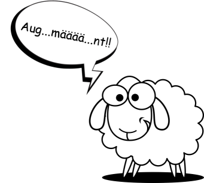 -

Currently implemented: flips and 90 degree rotations, rotations, scaling, shifts, elastic deformations, crops, intensity changes, noise, blur, cutouts, color jitter and H&E stain augmentation (see [Available augmentations](#available-augmentations)).

## Installation

Requires Python >= 3.10.

`pip install augmend`

With optional GPU support (via [`gputools`](https://github.com/maweigert/gputools)):

`pip install "augmend[gpu]"`

With H&E stain augmentation (via `scikit-learn`):

`pip install "augmend[he]"`

From source:

`pip install git+https://github.com/stardist/augmend.git`

## Usage

### Basic augmentation pipeline (single images)

First instantiate an augmentation pipeline class and then populate it with augmentation transforms (e.g. fliprotations, elastic transforms, etc). 

```python
from augmend import Augmend           
from augmend import Elastic, FlipRot90, AdditiveNoise

# define augmentation pipeline
aug = Augmend()

# define transforms
aug.add(FlipRot90(axis = (0,1)), probability=1)
aug.add(Elastic(axis = (0,1)),probability=1)
aug.add(AdditiveNoise(sigma = 0.3),probability=1)
#...

```

Afterwards, it can be applied to an image `img` by simply calling `aug(img)`

```python 
import numpy as np 
import matplotlib.pyplot as plt 

# input
img = np.zeros((128, 128), np.float32)
img[::16] = 1 

# output
result = aug(img)


plt.subplot(121);plt.title("img");plt.imshow(img)
plt.subplot(122);plt.title("result");plt.imshow(result)

```
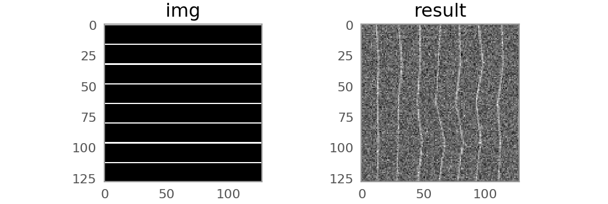

### Simultanously transforming several images

Often, one is given several input images `[X,Y,...]` that need to be transformed the same way e.g. image/label pairs for supervised learning). 
To that end, `Augmend.add` accepts a list of transforms, which then will be applied to each image in the input with the same random seed.

```python 
aug.add([FlipRot90(),FlipRot90()], probability=1)

[X2,Y2] = aug([X,Y])

```

### Random number generators

By default, numpy's global random state is used, so `np.random.seed(...)` makes results reproducible. Alternatively, pass a `np.random.RandomState` or `np.random.Generator`, either when creating the pipeline (`Augmend(rng=...)`) or per call (`aug(x, rng=...)`). With PyTorch `DataLoader` workers, avoid passing a fixed `rng` when creating the pipeline, since every worker receives a copy of it and produces the same augmentations (see below).

### Augmenting in 3D

Should work the same way - in fact, almost all augmentations should accept nD arrays. The axis over which the transformation is applied can be typically set via the `axis` parameter in the transform object, e.g. `FlipRot90(axis = (0,1,2))`.

Example:


```python
import numpy as np
from augmend import Augmend, Elastic, FlipRot90

# define augmentation pipeline
aug = Augmend()
aug.add([FlipRot90(axis=(0, 1, 2)),
         FlipRot90(axis=(0, 1, 2))],
        probability=0.9)

aug.add([Elastic(axis=(0, 1, 2), amount=5, order=1),
         Elastic(axis=(0, 1, 2), amount=5, order=0)],
        probability=0.9)

# example 3d image and label
x = np.zeros((100,) * 3, np.float32)
x[-20:, :20, :20] = 1.
x[30:40, -10:] = .8
Xs = np.meshgrid(*((np.arange(0, 100),) * 3), indexing="ij")
R = np.sqrt(np.sum([(X - c) ** 2 for X, c in zip(Xs, (70, 60, 50))], axis=0))
x[R < 20] = 1.4
y = np.zeros((100,) * 3, np.uint16)
y[R < 20] = 200

# resulting volume
res = aug([x, y])
```

Should result in a similar output like this (From left to right: original and 4 augmented volumes. Top and bottom, image `x` and labels `y`).


### Usage with a data generator 

In a supervised learning setting, one often constructs a data generator  that yeilds batches of array pairs 

```python
# a simple data generator (might as well return several arrays, as for a supervised data generator) 
def data_gen():
    for i in range(4):
        yield x_batch, y_batch
```

`Augmend.flow` allows to wrap that generator into the augmented one, like so

```python
aug = Augmend()

aug.add([FlipRot90(axis=(1, 2)),
         FlipRot90(axis=(1, 2))],
        probability=0.9)

aug_gen = aug.flow(data_gen())

# get the results as tuple
res = next(aug_gen)
```
### Usage with PyTorch

Call the pipeline inside `Dataset.__getitem__`. Drawing the seed from torch gives each `DataLoader` worker and epoch different augmentations, and `torch.manual_seed` makes them reproducible:

```python
import numpy as np
import torch
from torch.utils.data import DataLoader, Dataset
from augmend import Augmend, Elastic, FlipRot90

aug = Augmend()
aug.add([FlipRot90(axis=(0, 1)), FlipRot90(axis=(0, 1))])
aug.add([Elastic(axis=(0, 1), amount=5, order=1),
         Elastic(axis=(0, 1), amount=5, order=0)])


class AugmentedDataset(Dataset):
    def __init__(self, x, y, aug):
        self.x, self.y, self.aug = x, y, aug

    def __len__(self):
        return len(self.x)

    def __getitem__(self, i):
        rng = np.random.RandomState(torch.randint(0, 2**32, ()).item())
        x, y = self.aug([self.x[i], self.y[i]], rng=rng)
        # flips return views with negative strides, which torch.from_numpy rejects
        return torch.from_numpy(np.ascontiguousarray(x)), torch.from_numpy(np.ascontiguousarray(y))


loader = DataLoader(AugmentedDataset(x, y, aug), batch_size=4, num_workers=4)
```

For `tf.data` pipelines, wrap the pipeline with `tf.numpy_function`.

### RGB and histology (H&E) images

`ColorJitter` randomly changes brightness, contrast, saturation and hue of RGB images (channels last, `uint8` or float in [0, 1]), following the definitions of torchvision's `ColorJitter`.

`HEStaining` estimates the hematoxylin and eosin stain vectors of an RGB image (channels last, `uint8` or float in [0, 1]) and randomly perturbs them and the stain amounts. Tiles with too little tissue are returned unchanged. For images with a bright background, `IntensityScaleShift(invert=True)` scales and shifts `1 - x`, so the background stays bright:

```python
from augmend import Augmend, ColorJitter, FlipRot90, HEStaining, Identity, IntensityScaleShift

aug = Augmend()
aug.add([FlipRot90(axis=(0, 1)), FlipRot90(axis=(0, 1))])
aug.add([HEStaining(amount_matrix=0.15, amount_stains=0.4), Identity()])
aug.add([IntensityScaleShift(scale=(0.8, 1.2), shift=(-0.1, 0.1), axis=(0, 1), invert=True), Identity()])
aug.add([ColorJitter(brightness=0.1, contrast=0.1, saturation=0.1, hue=0.02), Identity()])

img2, lbl2 = aug([img, lbl])  # img: float RGB in [0, 1] of shape (H, W, 3)
```

### Transforming arrays on the GPU

`Scale`, `IsotropicScale`, `Rotate`, `Shift` and `Elastic` take `mode` and `cval`, so that image and labels can be filled differently, e.g. a reflected image with labels of -1 for pixels to ignore:

```python
from augmend import Augmend, Scale

aug = Augmend()
aug.add([Scale(axis=(0, 1), amount=(0.7, 1.3), order=1, mode="reflect"),
         Scale(axis=(0, 1), amount=(0.7, 1.3), order=0, mode="constant", cval=-1)])
```

Some transforms (e.g. `Elastic` and `Scale`) allow to use the GPU for the transformation (which can be a bottleneck) via the keyword `use_gpu`. This requires additionally the installation of [`gputools`](https://github.com/maweigert/gputools), e.g. via `pip install "augmend[gpu]"`.


### Available augmentations

Each example shows the input followed by three random outputs, created with [`scripts/create_examples_readme.py`](scripts/create_examples_readme.py) from the example images in `augmend.data` (`test_image_nuclei_2d()` and `test_image_he_2d()`, as in `stardist.data`). Parameters not shown use their defaults.

| Transform | Description | Example |
| --- | --- | --- |
| **Geometric** | | |
| `FlipRot90()` | Random flip and axis permutation (90 degree rotation) of the axes in `axis` | 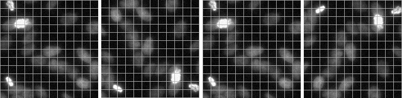 |
| `Flip()` | Random flip of the axes in `axis` | 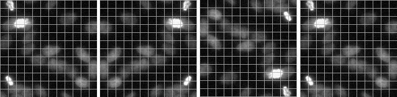 |
| `Rotate()` | Rotation by a random angle (random rotation matrix in nD) | 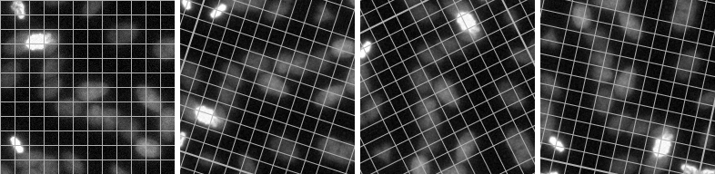 |
| `Scale(amount=(0.5, 2))` | Zoom by a random factor per axis, keeping the image shape; `isotropic=(low, high)` adds one factor shared by all axes (drawn with `isotropic_probability`), in the same interpolation | 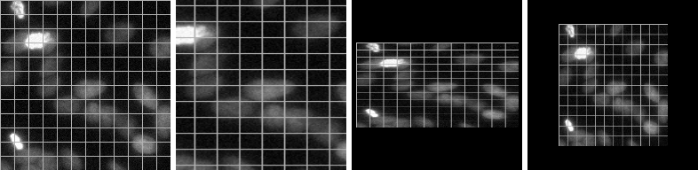 |
| `IsotropicScale(amount=(0.5, 2))` | Zoom by the same random factor for all axes | 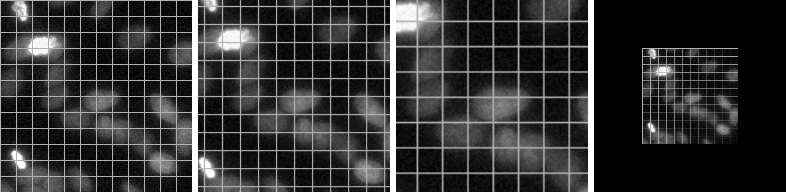 |
| `Shift(amount=(-30, 30))` | Shift by a random number of pixels per axis | 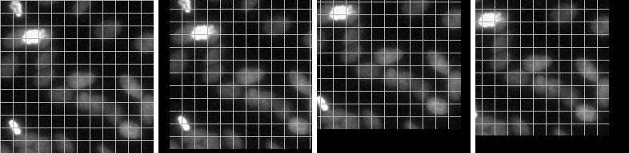 |
| `Elastic(grid=5, amount=8)` | Random displacements (at most `amount` pixels) on a coarse grid of `grid` points per axis, interpolated to all pixels | 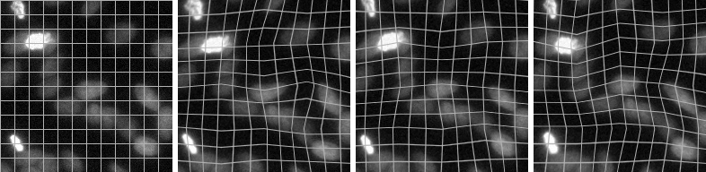 |
| `RandomCrop(size=(96, 96))` | Crop of the given size at a random position | 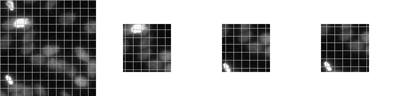 |
| **Intensity** | | |
| `IntensityScaleShift(scale=(0.5, 2), shift=(-0.2, 0.2))` | `x * s + t` with random `s` and `t`; axes not in `axis` (e.g. channels) get independent values | 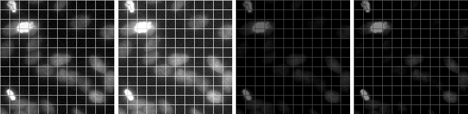 |
| `AdditiveNoise(sigma=0.1)` | Additive Gaussian noise; `sigma` is the standard deviation or a range to draw it from | 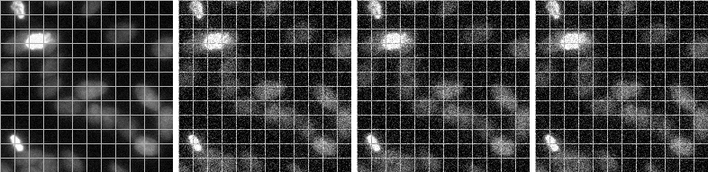 |
| `GaussianBlur(amount=(1, 4))` | Gaussian blur with a random sigma per axis | 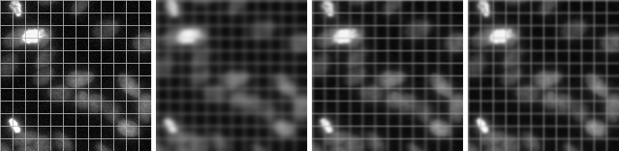 |
| **Masking** | | |
| `CutOut(width=(10, 30), n=(2, 6))` | Set a random number of boxes with random size to `val` | 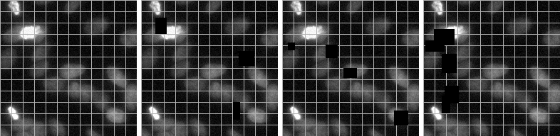 |
| `DropPlanes(n=3, width=6)` | Set `n` random planes (rows or columns in 2D) of thickness `width` along a random axis to `val` | 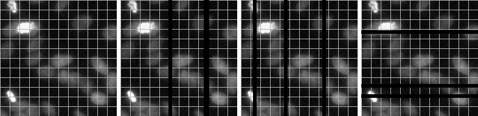 |
| `DropEdgePlanes(width=30)` | Set the planes of thickness `width` at a random edge to `val` | 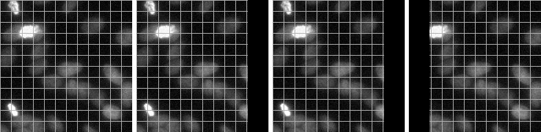 |
| **RGB (channels last, `uint8` or float in [0, 1])** | | |
| `ColorJitter(brightness=0.3, contrast=0.3, saturation=0.3, hue=0.05)` | Random brightness, contrast, saturation and hue changes, as in torchvision's `ColorJitter` | 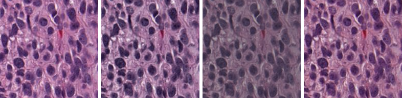 |
| `HEStaining()` | Random perturbation of the estimated H&E stain vectors and stain amounts (requires `augmend[he]`) | 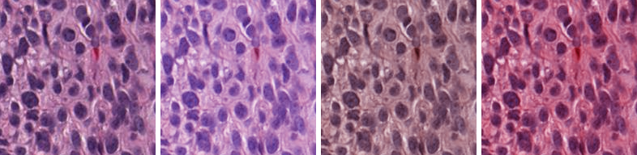 |
| `IntensityScaleShift(scale=(0.5, 1.5), shift=(-0.1, 0.1), axis=(0, 1), invert=True)` | Scale and shift `1 - x` per channel, so a bright background stays bright | 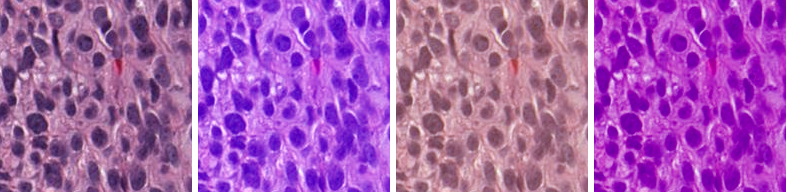 |

Transforms can be combined: `t1 + t2` applies both in sequence, `t1 | t2` applies one of them chosen at random. `Identity()` leaves the input unchanged (e.g. for labels that should not get intensity changes), and `Lambda(func)` wraps a function `func(x, rng)`.
